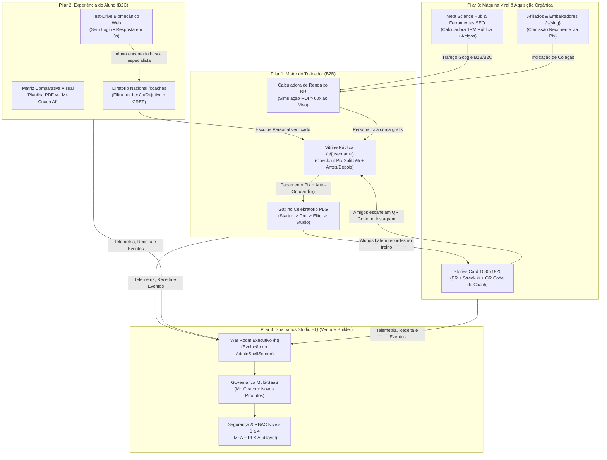
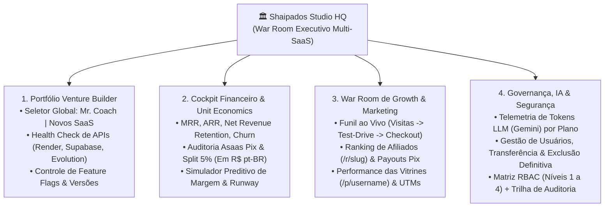
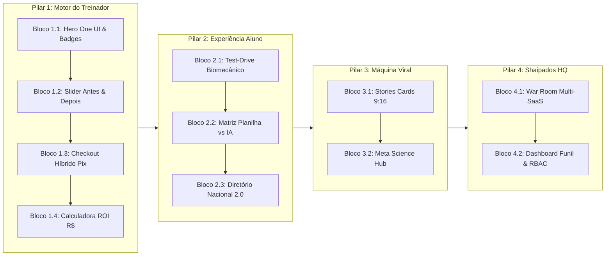

# 🚀 Proposta Estratégica: Modernização das Páginas Públicas, Motor Viral e Backoffice Executivo (HQ)
## Ecossistema Mr. Coach & Shaipados Labs (Versão 2.0 — Otimizada & Auditada)

> **Status:** PROPOSTA ESTRATÉGICA REVISTA E AMPLIADA (Pronta para Execução)  
> **Data de Emissão:** 23 de Outubro de 2026  
> **Liderança & Direção:** Prof. Cleudson Cavalcante (CEO / CPO)  
> **Elaboração & Auditoria Arquitetural:** Antigravity / Tech Lead (Squad Galaxy & Squad Lenovo)  
> **Escopo:** Páginas Públicas Comerciais, Vitrine do Treinador 2.0, Test-Drive Biomecânico do Aluno, Motor Viral B2B2C e Módulo Privativo HQ (Venture Builder)  
> **Guardrails Obrigatórios:** `Visual_Edge_to_Edge_Mobile.md`, `design_system_meta_style.md`, `arquitetura_shaipados_labs.md` e Padrão Monetário `CurrencyPtBr` (`R$`)  

---

## 1. Visão Geral & Diagnóstico Estratégico

O ecossistema **Mr. Coach** consolidou uma arquitetura mobile e backend de classe mundial (v1.9.0+ com mais de 151.800 linhas de código, 44 migrações SQL com RLS estrito, design *One UI 7 / Edge-to-Edge* nas 4 abas do aluno e mais de 230 testes automatizados verdes). O produto interno atingiu maturidade de retenção.

O foco estratégico agora é a **virada de chave comercial, viralidade orgânica (PLG) e governança executiva**:

1. **Para o Treinador (B2B — Aquisição & Upgrade):** A plataforma pública deve operar como um funil de vendas autônomo para que o personal capte alunos de consultoria online sem depender apenas de indicação boca a boca. Quanto mais rápido ele lota sua carteira, mais rapidamente atinge o teto de alunos do seu plano atual e realiza o upgrade orgânico (*Starter → Pro → Elite → Studio*).
2. **Para o Aluno (B2C — Quebra de Objeção Imediata):** O praticante de musculação quer acompanhamento, mas teme pagar por uma "planilha de PDF estática" sem suporte quando sente dor ou encontra aparelhos ocupados. A web pública deve provar a inteligência biomecânica do Mr. Coach **em menos de 3 segundos, sem exigir login**.
3. **Para o SaaS (Mr. Coach — Loop Viral B2B2C):** Cada treino finalizado, cada série de ofensiva (*Streak* 🔥) e cada recorde pessoal (*PR*) deve gerar ativos sociais para Instagram Stories, TikTok e WhatsApp com atribuição direta ao personal trainer e ao ecossistema (`shaipados.com`).
4. **Para a Venture Builder (Shaipados Labs — Governança HQ):** Unificar e expandir a suíte administrativa já existente (`/admin` com 10 módulos operacionais) para o **War Room Executivo (`/hq`)**, permitindo governança multi-produto, auditoria financeira em tempo real (MRR, ARR, Runway, Split Asaas 5%), inteligência de tráfego (UTMs/Afiliados) e controle de acesso corporativo (RBAC Níveis 1 a 4).

---

## 2. Auditoria do Monorepo: O Que Já Temos vs. Onde Vamos Evoluir

Uma análise técnica do repositório atual revela uma vantagem competitiva enorme: **não partiremos do zero**. Já possuímos fundações sólidas que serão potencializadas:

| Ativo no Monorepo | Arquivo / Rota Atual | Estado Atual | Evolução Proposta (V2.0) |
|---|---|---|---|
| **Landing B2B Treinador** | [`b2b_landing_screen.dart`](../mobile/lib/features/landing/b2b_landing_screen.dart) (`/b2b`) | 476 linhas; apresentação institucional estática. | Inserir **Calculadora Interativa de ROI em R$ (pt-BR)**, comparativo dinâmico e prova social ao vivo. |
| **Vitrine do Personal** | [`trainer_public_landing_screen.dart`](../mobile/lib/features/landing/trainer_public_landing_screen.dart) (`/prof/{user}`) | 1.979 linhas; perfil público com planos de consultoria. | Criar rota curta alias **`/p/{user}`**, slider **Antes & Depois**, **Checkout Híbrido Pix Asaas (Split 5%) + WhatsApp CRM** e OpenGraph dinâmico. |
| **Diretório de Coaches** | [`public_trainer_directory_screen.dart`](../mobile/lib/features/landing/public_trainer_directory_screen.dart) (`/prof`) | 257 linhas; busca simples de treinadores. | Filtros inteligentes por **Especialidade Clínica/Biomecânica**, Cidade/UF, Modalidade e selo **CREF Verificado**. |
| **Landing de Afiliados** | [`referral_landing_screen.dart`](../mobile/lib/features/referral/screens/referral_landing_screen.dart) (`/r/{slug}`) | Captura de indicação persistida via `ReferralService`. | Integrar painel de comissões recorrentes e **Payout Pix Automático** via Asaas. |
| **Portal de IA & Ciência** | [`ai_news_screen.dart`](../mobile/lib/features/landing/ai_news_screen.dart) (`/ai`) | 477 linhas; feed de notícias de IA. | Expandir para o **Meta Science Hub (`/science`)** com calculadoras públicas de 1RM/Volume e SEO estruturado. |
| **Backoffice Admin** | [`admin_shell_screen.dart`](../mobile/lib/features/admin/admin_shell_screen.dart) (`/admin`) | 10 telas prontas (Finanças, Simulador, Retenção, IA, WhatsApp, Auditoria). | Evoluir para o **Shaipados Studio HQ (`/hq`)** com seletor Multi-SaaS, Funil de Marketing/UTMs e RBAC Níveis 1 a 4. |

---

## 3. Benchmark de Mercado: Como os Grandes Players Executam

| Player Global | Princípio Estratégico | Como Executam na Web Pública | Transposição Direta para o Mr. Coach |
|---|---|---|---|
| **Shopify & Substack** | **"Merchant Success Flywheel"** (A plataforma cresce quando o cliente vende mais). | Vitrines de alta conversão com checkout em 1 clique sem fricção técnica. | A **Vitrine `/p/{username}`** vira uma máquina de vendas com contratação Pix instantânea (95% Personal / 5% Plataforma) e auto-onboarding do aluno. |
| **Stripe & Vercel** | **"Show, Don’t Tell"** (Demonstração interativa antes do cadastro). | Playgrounds interativos na própria homepage que entregam valor em 3 segundos. | **Test-Drive Biomecânico na Landing Page**: o visitante simula uma dor ou aparelho ocupado e vê a IA recalcular o exercício ao vivo. |
| **Whoop, Strava & Apple** | **"Ciência & Prestígio Social"** (Transformar esforço físico em símbolo de status). | Cards verticais de telemetria esteticamente impecáveis prontos para Stories. | **Stories Card 1-Click (1080×1920)**: Card com Recorde Pessoal (PR), Ofensiva 🔥, QR Code da vitrine do Personal e selo *Mr. Coach AI*. |
| **Linear & Samsung One UI 7** | **"Design Tátil como Vantagem Competitiva"** | Dark Glassmorphism refinado, bordas luminosas de 1px, ambient glow e 120 FPS. | Continuidade visual absoluta entre as Landing Pages e a nova experiência *Edge-to-Edge* do App do Aluno. |

---

## 4. Arquitetura Integrada dos 4 Pilares (Flywheel B2B2C)



---

### PILAR 1: O Motor de Crescimento do Treinador (Flywheel de Upgrade)
> **Objetivo Comercial:** Capacitar o personal trainer a captar alunos online em escala, tornando o upgrade de plano (*Starter → Pro → Elite → Studio*) uma decisão matemática óbvia.

#### 1.1. Vitrine Pública do Personal 2.0 (`/p/{username}` e `/prof/{username}`)
Evoluindo a atual `TrainerPublicLandingScreen` para uma **Landing Page de Alta Conversão B2B2C**:
- **Rota Curta Amigável para Bio do Instagram:** Suporte simultâneo a `/p/nome` e `/prof/nome`.
- **Hero de Autoridade & Confiança:** Foto em alta definição com anel luminoso Esmeralda, badge **`CREF Verificado`** (validado no cadastro), nota média de satisfação dos alunos ativos, contador real de *"Treinos Prescritos com IA"* e tags clicáveis de especialidades (*Hipertrofia*, *Reabilitação de Joelho/Ombro*, *Emagrecimento Feminino*, *Terceira Idade*).
- **Galeria Interativa "Antes & Depois" com Contexto Clínico:** Slider tátil horizontal comparando a evolução do aluno com selo de duração real (ex.: *"16 semanas • +4,2 kg de massa magra • Zero dor lombar"*).
- **Fluxo de Contratação Híbrido (Self-Checkout Pix vs. WhatsApp Consultivo):**
  1. **Contratação Imediata (Self-Service Asaas):** O visitante escolhe o plano do treinador (Mensal, Trimestral ou Semestral formatado em `R$ 1.250,00`), gera o QR Code Pix / Copia e Cola na hora com **Split automático (95% Treinador / 5% Plataforma)**. Assim que o webhook Asaas confirma o pagamento (em ~3 segundos), o aluno é redirecionado automaticamente para a **Anamnese Inteligente (`/onboarding`)** já vinculado à carteira daquele treinador!
  2. **Atendimento Consultivo (WhatsApp com Lead Tracking):** Caso o aluno queira conversar antes de pagar, o botão *"Falar com o Coach no WhatsApp"* registra o evento na tabela `public_lead_events` (com origem UTM) e abre o WhatsApp com mensagem contextualizada (plano de interesse + objetivo).
- **Preview da Experiência Mr. Coach:** Uma seção compacta na vitrine do treinador mostrando ao futuro aluno que ele terá acesso ao **App Exclusivo com Modo Foco, IA Biomecânica 24h e Bio-Hub**.

#### 1.2. Calculadora Interativa de Faturamento & Tempo Economizado (Padrão `R$` pt-BR)
Na landing page B2B (`mrcoach.shaipados.com` / `/b2b`), um simulador financeiro e operacional ao vivo:
- **Controles Deslizantes (Sliders):**
  - *Quantos alunos de consultoria você quer atender?* (`5` a `150` alunos).
  - *Qual o ticket médio da sua mensalidade?* (`R$ 100,00` a `R$ 800,00`).
- **Output Dinâmico Instantâneo (Formatado em Real Brasileiro):**
  - **Faturamento Mensal Projetado:** Ex.: `30 alunos × R$ 250,00 = R$ 7.500,00/mês` (`R$ 90.000,00/ano`).
  - **Horas Devolvidas à sua Vida:** *"No método antigo (Planilha/PDF): **35 horas/mês**. Com Mr. Coach AI: **25 minutos/mês** (Economia de **34h35min** todo mês)."*
  - **Plano Ideal Recomendado Automaticamente:** Conforme o slider passa de 3, 30 ou 80 alunos, o card destaca automaticamente o plano ideal (*Pro*, *Elite* ou *Studio*) e exibe o ROI: *"Investimento de apenas **R$ 89,90/mês** (1,19% do seu faturamento — **ROI de 83x**)"*.
  - **CTA de Ação Imediata:** *"Começar Agora no Plano Starter Grátis (Até 3 Alunos)"*.

#### 1.3. Esteira de Notificação Celebratória de Upgrade (Product-Led Growth)
- Quando o treinador atinge 100% da capacidade do plano gratuito (*3/3 alunos no Starter*) ou tenta adicionar o 4º aluno, em vez de um erro frio de bloqueio, exibe-se um **Modal Celebratório One UI**:
  > *"🏆 Carteira Starter Completa! Você já está impactando 3 alunos com IA. Treinadores que desbloqueiam o Plano Pro adicionam em média +9 alunos nos primeiros 30 dias. Faça o upgrade em 1 clique via Pix e libere até 30 alunos agora."*

---

### PILAR 2: A Experiência do Aluno (Quebra de Objeções & Test-Drive em 3 Segundos)
> **Objetivo Comercial:** Provar para o aluno de academia que uma consultoria equipada com Mr. Coach é incomparavelmente superior a qualquer PDF ou aplicativo genérico de ficha.

#### 2.1. Test-Drive Biomecânico Interativo na Web (Zero Login / Zero Fricção)
Acima da dobra na página pública, um widget interativo inspirado na interface *One UI 7 Glassmorphism* do app:
- **Passo 1 (Escolha o Exercício):** Chips rápidos com ícones: `Agachamento Livre`, `Supino Reto Barra`, `Leg Press 45°`, `Desenvolvimento Halteres`, `Puxada Alta`.
- **Passo 2 (Simule a Situação Real no Salão):**
  - `⚠️ Sinto desconforto na lombar/ombro`
  - `⏳ Aparelho lotado no horário de pico`
  - `🏠 Vou precisar treinar em casa/hotel hoje`
- **Passo 3 (Resposta Ao Vivo da IA Biomecânica em < 2s):**
  - Exibe um card translúcido com o **Vetor Muscular Equivalente**, o exercício substituto ideal, o ajuste de angulação articular para zerar a compressão e a equivalência automática de carga sugerida.
- **Ponte Direta para Conversão (B2C → B2B):**
  - Dois botões de ação no rodapé do resultado:
    1. **"Quero um Personal Credenciado para me Acompanhar"** → Leva ao Diretório `/coaches` já filtrado pela especialidade selecionada!
    2. **"Sou Personal e Quero Essa IA para Meus Alunos"** → Leva ao cadastro B2B `/professor/cadastro`.

#### 2.2. O Comparativo Visual Definitivo: "Consultoria Antiga" vs. "Consultoria Mr. Coach AI"
Layout Bento Grid lado a lado destacando a dor real do aluno:

| Situação Real na Academia | ❌ Consultoria Antiga (Planilha / PDF / App Genérico) | ✅ Consultoria Equipada com Mr. Coach AI |
|---|---|---|
| **Aparelho Ocupado às 19h** | Aluno espera 15 minutos esfriando o corpo ou pula o exercício. | Toque em *"Aparelho Ocupado"*: IA sugere substituto com mesmo vetor biomecânico em 3 segundos. |
| **Dor ou Fisgada Articular** | Aluno força a articulação, agrava a lesão e cancela a consultoria. | Botão SOS Biomecânico adapta o movimento na hora e notifica o treinador no painel. |
| **Evolução de Cargas e 1RM** | Aluno esquece quanto pegou na semana passada; estagnação (platô). | Memória automática da última carga, cálculo de 1RM (Epley/Brzycki) e gráfico no **Bio-Hub**. |
| **Foco e Tempo de Descanso** | Aluno abre redes sociais, descansa 4 minutos e perde intensidade. | **Modo Foco Edge-to-Edge** com cronômetro inteligente, alertas táteis e anel de progresso. |
| **Conexão com o Treinador** | Mensagens perdidas no WhatsApp e feedback só no mês seguinte. | Telemetria em tempo real: o treinador vê cada série, RPE e recorde batido no dia. |

#### 2.3. Diretório Nacional de Treinadores Verificados (`/coaches` e `/prof`)
Evolução da `PublicTrainerDirectoryScreen` para um verdadeiro **Marketplace de Confiança**:
- **Filtros Combinados Instantâneos:**
  - *Objetivo / Condição:* Hipertrofia, Emagrecimento, Reabilitação Articular (Joelho, Lombar, Ombro), Gestantes/Pós-parto, Longevidade 60+, Performance Esportiva.
  - *Modalidade:* 100% Online, Híbrido ou Presencial (com filtro por Cidade/UF).
  - *Faixa de Investimento Mensal:* Até `R$ 150,00`, `R$ 150,00 a R$ 300,00`, Premium (`+R$ 300,00`).
- **Ordenação por Mérito (Gamificação B2B):** Treinadores com perfil 100% preenchido, CREF verificado e maior taxa de adesão dos alunos ganham destaque orgânico no topo do diretório (*Badge Top Coach*).

---

### PILAR 3: A Máquina Viral do Mr. Coach (K-Factor & SEO Científico)
> **Objetivo Comercial:** Transformar cada aluno em um outdoor digital orgânico do seu Personal Trainer e da marca Mr. Coach.

#### 3.1. Social Share Cards 2.0 para Instagram Stories (1080×1920) com QR Code de Atribuição
Ao concluir um treino no `ActiveWorkoutScreen` ou bater um Recorde Pessoal (PR), o botão **"Compartilhar Conquista"** gera uma arte nativa em alta definição (9:16):
- **Design Editorial Esportivo (*One UI 7 + Nike/Whoop Style*):**
  - Fundo *Obsidian Dark* com *Ambient Glow* dinâmico na cor do nível do aluno (Esmeralda, Ciano, Ouro).
  - **Headline de Impacto:** Ex.: `NOVO RECORDE PESSOAL • +12% DE FORÇA` ou `OFENSIVA IMBATÍVEL • 14 DIAS SEGUIDOS 🔥`.
  - **Métricas Auditadas:** Tonelagem total da sessão (ex.: `8.450 kg movidos`), duração, exercícios concluídos e grupo muscular alvo.
  - **Co-Branding Duplo (O Segredo Viral):**
    - Assinatura em destaque do treinador: **`Prescrito por Coach [Nome] (@insta_do_coach)`**.
    - **QR Code Dinâmico + Link Curto (`shaipados.com/p/username`):** Qualquer amigo do aluno que tirar print ou escanear o Story cai diretamente na Vitrine de Vendas daquele Personal Trainer!
    - Selo oficial de rodapé: **`Tecnologia Mr. Coach AI • Biomecânica Inteligente`**.

#### 3.2. Ferramentas Gratuitas & Meta Science Hub (Ímãs de Tráfego SEO)
Além de artigos técnicos, páginas interativas públicas que ranqueiam no topo do Google para buscas diárias de praticantes e profissionais de Educação Física:
1. **Calculadora Pública de 1RM e Zona de Hipertrofia (`/science/1rm`):** O visitante digita a carga e repetições realizadas e recebe sua tabela completa de percentuais (50% a 100% 1RM pelas equações de Epley, Brzycki e Lombardi) + CTA para controlar automaticamente no app.
2. **Auditório de Volume Semanal MEV/MAV/MRV (`/science/volume`):** Ferramenta rápida para personals verificarem se o volume de séries por grupamento muscular está na faixa ótima de hipertrofia.
3. **Artigos Técnicos Indexáveis:** Guias práticos sobre substituição biomecânica, periodização ondulatória e prevenção de lesões articulares.

#### 3.3. Estratégia de SEO Técnico & OpenGraph Dinâmico para Flutter Web
Como aplicações Flutter Web (SPA) renderizam em canvas, implementaremos uma camada leve de **Meta-Tags & OpenGraph Dinâmicos no Hosting/Edge**:
- Quando um link `/p/{username}` for compartilhado no WhatsApp, Instagram ou LinkedIn, o crawler receberá instantaneamente `og:title` (*"Consultoria Online com Coach [Nome] • CREF Verificado"*), `og:description` e `og:image` (card personalizado do treinador), multiplicando a taxa de cliques (CTR) no WhatsApp.
- Geração automatizada de `sitemap.xml` listando todas as vitrines públicas de treinadores ativos e páginas do *Meta Science Hub*.

#### 3.4. Programa de Embaixadores e Afiliados B2B (`/r/{slug}`)
- Todo treinador ativo recebe seu link de indicação `/r/{username}` no painel.
- Ao indicar outro colega Personal Trainer que assine os planos *Pro*, *Elite* ou *Studio*, o indicador recebe **comissão recorrente via Split/Payout Pix automático** ou crédito abatido na própria assinatura, acompanhado em tempo real.

---

### PILAR 4: O "War Room / HQ" da Venture Builder (Shaipados Labs)
> **Objetivo de Governança:** Consolidar o `AdminShellScreen` existente em uma Cabine de Comando Executiva Multi-SaaS (`/hq`) blindada para o CEO e diretorias.

#### 4.1. Arquitetura do Espaço Executivo (`/hq` e `hq.shaipados.com`)
Aproveitando os 10 módulos já construídos em `mobile/lib/features/admin/`, o **Shaipados Studio HQ** adicionará uma camada superior de governança da Venture Builder:



#### 4.2. Matriz de Permissões e Acessos Corporativos (RBAC Níveis 1 a 4)
Implementação via tabela `hq_role_assignments` no Supabase com políticas RLS restritivas e suporte a 2FA:

| Nível RBAC | Papel Corporativo | Escopo de Visibilidade e Ações Permitidas no `/hq` |
|---|---|---|
| **Nível 1 — `CEO_FOUNDER`** | Presidência / CEO (Prof. Cleudson) | **Acesso Total (God Mode Auditado):** Portfólio completo da Venture Builder, alteração dinâmica de preços (`AdminPricingManager`), autorização de saques/estornos Pix, exclusão definitiva de contas, chaves de sistema e nomeação de diretores. |
| **Nível 2 — `CFO_FINANCE`** | Diretoria Financeira & Contábil | Acesso aos módulos **Financeiro & Unit Economics** e **Simulador de Margem**: exportação de relatórios contábeis CSV/PDF, conciliação de webhooks Asaas, auditoria de Split 5% e gestão de inadimplência (*Dunning*). Sem acesso a prompts de IA ou exclusão de usuários. |
| **Nível 3 — `CMO_GROWTH`** | Growth, Marketing & Copy (Sarah / Sofia) | Acesso aos módulos de **Retenção, Broadcast, Diretório e Funil de Conversão**: métricas de UTMs das landing pages, aprovação de selos *Top Coach*, gestão de campanhas de WhatsApp/Push e ranking de afiliados. Sem acesso a dados bancários sensíveis. |
| **Nível 4 — `CTO_SRE_SUPPORT`** | Engenharia, SRE & Suporte N2 (Arthur / Beto / Alan) | Acesso aos módulos de **Consumo de IA, Instâncias WhatsApp, Exercícios 3D e Logs de Auditoria**: reprocessamento de webhooks, monitoramento de latência e suporte técnico a treinadores e alunos. |

---

## 5. Topologia Técnica Monorepo & Roteamento Unificado (`main.dart`)

Todas as rotas públicas, vitrines e o backoffice HQ coexistem no mesmo bundle otimizado, garantindo custo zero de infraestrutura adicional e compartilhamento de Design System:

```dart
// Roteamento Domain-Aware + Path-Aware no mobile/lib/main.dart
final host = Uri.base.host;
final path = uri.path;

// 1. Backoffice Executivo (Subdomínio dedicado ou rota autenticada)
if (host.startsWith('hq.') || path == '/hq' || path == '/admin') {
  return AdminShellScreen(isHqMode: true); // Protegido por AdminAccessGuard + RBAC 1..4
}

// 2. Rotas Dinâmicas de Aquisição e Viralidade
if (segments.length >= 2 && (segments[0] == 'p' || segments[0] == 'prof')) {
  return TrainerPublicLandingScreen(username: segments[1]); // Vitrine 2.0 com Checkout Pix
}
if (path == '/coaches' || path == '/treinadores' || path == '/prof') {
  return const PublicTrainerDirectoryScreen(); // Diretório Nacional Verificado
}
if (path.startsWith('/science') || path == '/ai') {
  return const AiNewsScreen(); // Evoluído para Meta Science Hub + Calculadoras SEO
}
```

---

## 6. Plano de Execução: Desenvolvimento Atômico em Blocos Enxutos (Squad Galaxy & Squad Lenovo)

> **Padrão Oficial de Engenharia:** Conforme formalizado em `squad_mrcoach.md`, toda a implementação é executada em **pequenos blocos autocontidos (1 bloco por solicitação)**, preservando a cota de tokens das IAs, eliminando riscos de regressão e mantendo o repositório (`origin/main`) sincronizado com validações contínuas.



### **Roteiro Detalhado em Blocos Atômicos**

#### **PILAR 1: O Motor de Crescimento do Treinador (Flywheel B2B)**
- [x] **Bloco 1.1 — Vitrine Pública 2.0: Hero One UI, Badges Verificadas e Estatísticas**:
  - *Arquivo principal:* `mobile/lib/features/landing/trainer_public_landing_screen.dart`
  - *Entrega:* Visual Edge-to-Edge translúcido com Ambient Glow, botão de compartilhamento rápido com cópia do link no topo, badge oficial de CREF Verificado unificada (`🛡️ CREF • VERIFICADO`), bio persuasiva e big numbers de autoridade (estrelas ⭐, alunos acompanhados e experiência). *(Concluído)*
- [x] **Bloco 1.2 — Vitrine Pública 2.0: Slider Interativo Antes & Depois**:
  - *Arquivo principal:* `mobile/lib/features/landing/trainer_public_landing_screen.dart`
  - *Entrega:* Componente deslizante interativo (`_BeforeAfterSplitCard`) com divisor tátil arrastável de alta precisão, presets rápidos (`Antes`, `50/50`, `Depois`), métricas comparativas em destaque e diferencial biomecânico aplicado. *(Concluído)*
- [x] **Bloco 1.3 — Vitrine Pública 2.0: Checkout Híbrido de Alta Conversão (Pix Asaas + WhatsApp CRM)**:
  - *Arquivo principal:* `mobile/lib/features/landing/trainer_public_landing_screen.dart`
  - *Entrega:* Card de planos com duplo canal de fechamento (Botão primário `Contratar Imediato (Pix / Cartão)` com split Asaas 95%/5% + Botão secundário `Tirar Dúvidas no WhatsApp` com contexto pré-preenchido), badges de garantia de 7 dias e vagas limitadas. *(Concluído)*
- [x] **Bloco 1.4 — Landing B2B (`b2b_landing_screen.dart`): Calculadora Interativa de Renda & ROI em R$**:
  - *Arquivo principal:* `mobile/lib/features/landing/b2b_landing_screen.dart`
  - *Entrega:* Simulador interativo com sliders dinâmicos de alunos e ticket médio em `CurrencyPtBr` (`R$`), presets rápidos de mercado, cálculo em tempo real de horas poupadas (~94%), demonstração de ROI e CTA direto para cadastro de treinador (`/professor/cadastro`). *(Concluído)*

#### **PILAR 2: A Experiência do Aluno & Test-Drive Biomecânico (B2C)**
- [x] **Bloco 2.1 — Widget de Test-Drive Biomecânico Web Público**:
  - *Arquivo principal:* `mobile/lib/features/landing/widgets/biomechanical_test_drive_widget.dart` / `b2b_landing_screen.dart`
  - *Entrega:* Componente modular de simulação instantânea (<100ms, 0 cadastro) cobrindo tanto dores articulares (ombro, lombar, joelho) quanto aparelhos ocupados no horário de pico, diagnóstico do vetor de força, sugestão de ajuste e exercício substituto com ponte para `/coaches`. *(Concluído)*
- [x] **Bloco 2.2 — Matriz Comparativa Visual (Planilha PDF vs Mr. Coach AI)**:
  - *Arquivo principal:* `mobile/lib/features/landing/b2b_landing_screen.dart`
  - *Entrega:* Grid Bento comparativo 2x3 simétrico One UI 7 destacando em verde e vermelho a diferença entre uma planilha PDF morta vs. acompanhamento inteligente com IA, feedback de dor/substituição de aparelhos, cobrança com split 95%/5% e callout de retenção de 85%. *(Concluído)*
- [x] **Bloco 2.3 — Diretório Nacional de Coaches 2.0 (`public_trainer_directory_screen.dart`)**:
  - *Arquivo principal:* `mobile/lib/features/landing/public_trainer_directory_screen.dart`
  - *Entrega:* Filtros dinâmicos por especialidade clínica/biomecânica (hipertrofia, emagrecimento, reabilitação lombar/ombro), localização e toggle de selo CREF, visual One UI 7, dados de autoridade e botão de contratação direta para `/p/{username}`. *(Concluído)*

#### **PILAR 3: A Máquina Viral do Mr. Coach (K-Factor & SEO)**
- [x] **Bloco 3.1 — Gerador de Stories Share Cards 1080×1920 (Instagram/TikTok)**:
  - *Arquivo principal:* `mobile/lib/core/widgets/workout_triumph_modal.dart` / `mobile/lib/features/client/active_workout_screen.dart`
  - *Entrega:* Modal de celebração pós-treino gerando imagem vertical estética para Stories (9:16) com Recorde Pessoal (PR) batido, fogo de ofensiva 🔥, QR Code da vitrine do personal `/p/{username}`, cópia de link de sticker e modo print imersivo. *(Concluído)*
- [x] **Bloco 3.2 — Meta Science Hub & Calculadoras SEO (`ai_news_screen.dart` / `/science`)**:
  - *Arquivo principal:* `mobile/lib/features/landing/ai_news_screen.dart`
  - *Entrega:* Hub de ciência aplicada com calculadoras abertas de 1RM e volume muscular semanal, gerando tráfego orgânico via Google e OpenGraph previews. *(Concluído)*

#### **PILAR 4: Shaipados Studio HQ — War Room Executivo Multi-SaaS (`/hq`)**
- [ ] **Bloco 4.1 — Unificação do Shell Executivo `/hq` com Seletor Multi-SaaS**:
  - *Arquivo principal:* `mobile/lib/features/admin/admin_shell_screen.dart` / `mobile/lib/main.dart`
  - *Entrega:* Roteamento direto `/hq` com navegação para os produtos da Venture Builder, telemetria financeira em tempo real (MRR/ARR/Inadimplência) e proteção RBAC.
- [ ] **Bloco 4.2 — Dashboard Executivo de Funil Público & Afiliados**:
  - *Arquivo principal:* `mobile/lib/features/admin/tabs/public_funnel_tab.dart`
  - *Entrega:* Monitoramento de cliques nos simuladores de ROI, conversão de vitrines públicas `/p/{user}` e comissões automáticas de afiliados.

---

## 7. Métricas Norte (North Star KPIs) & Instrumentação

Todo o funil público alimentará uma tabela enxuta de telemetria (`public_funnel_events`) visível no **Módulo 3 do HQ**:
1. **Taxa de Engajamento nos Simuladores:** `%` de visitantes únicos que interagem com a Calculadora de Renda B2B ou com o Test-Drive Biomecânico (Meta: **> 35%**).
2. **Tempo de Ativação "Pix → Primeiro Treino":** Tempo decorrido entre o pagamento Pix do aluno na vitrine `/p/{username}` e o preenchimento da Anamnese Inteligente (Meta: **< 3 minutos**).
3. **Taxa de Compartilhamento Viral (Story Rate):** `%` de treinos concluídos com Recorde Pessoal (PR) ou Ofensiva que geram exportação do Card 1080×1920 (Meta: **> 18%**).
4. **Taxa de Expansão PLG (Starter → Pago):** `%` de treinadores que atingem 3 alunos gratuitos e convertem para o plano *Pro* ou superior em até 14 dias (Meta: **> 45%**).

---

## 8. Critérios de Aceite e Garantia de Qualidade (Definition of Done)

1. **Estética *One UI 7* & *Edge-to-Edge*:** Todas as telas públicas e modais devem seguir a linguagem translúcida (`BackdropFilter`), bordas sutis de `1px`, *Ambient Glow* dinâmico e responsividade fluida de `320px` (mobile compacto) a `1920px+` (monitores ultrawide), sem quebras de texto ou *overflows*.
2. **Padrão Monetário Brasileiro (`CurrencyPtBr`):** Todo valor financeiro exibido ou editado nos simuladores, vitrines e no HQ deve utilizar estritamente o formato `R$ 1.234,56` (ponto para milhar, vírgula para centavos).
3. **Proteção de Codificação UTF-8:** 100% dos textos, acentuações e emojis verificados contra *mojibake*.
4. **Segurança Militar no HQ:** Nenhuma rota ou consulta do `/hq` confia apenas no frontend; todas as leituras e mutações exigem validação de JWT + Role RBAC (`CEO_FOUNDER`, `CFO_FINANCE`, `CMO_GROWTH`, `CTO_SRE_SUPPORT`) diretamente no backend FastAPI e nas políticas RLS do Supabase.
5. **Qualidade CI/CD:** Zero erros ou warnings no `flutter analyze` e cobertura de testes de widget para os novos componentes interativos.

---

## 9. Decisões Estratégicas Prontas para Deliberação do CEO

Para iniciarmos imediatamente a codificação da **Onda 1**, submetemos os 3 pontos de validação final:
1. **Partida Imediata da Onda 1:** Podemos iniciar agora pela implementação da **Calculadora Interativa de ROI (R$)** e do **Widget de Test-Drive Biomecânico** na Landing Page B2B/B2C, seguidos do upgrade da Vitrine `/p/{username}`?
2. **Modelo de Checkout na Vitrine do Personal (`/p/{username}`):** Confirmamos o **Modo Híbrido** (botão principal de *Contratação Imediata via Pix Asaas com Split 5%* + botão secundário *Tirar Dúvidas no WhatsApp com captura de Lead*)?
3. **Unificação do HQ (`/hq` + `/admin`):** Confirmamos a evolução direta do atual `AdminShellScreen` para o **Shaipados Studio HQ** (acessível tanto via `hq.shaipados.com` quanto `/hq`), aproveitando todos os 10 módulos financeiros e operacionais já testados?
