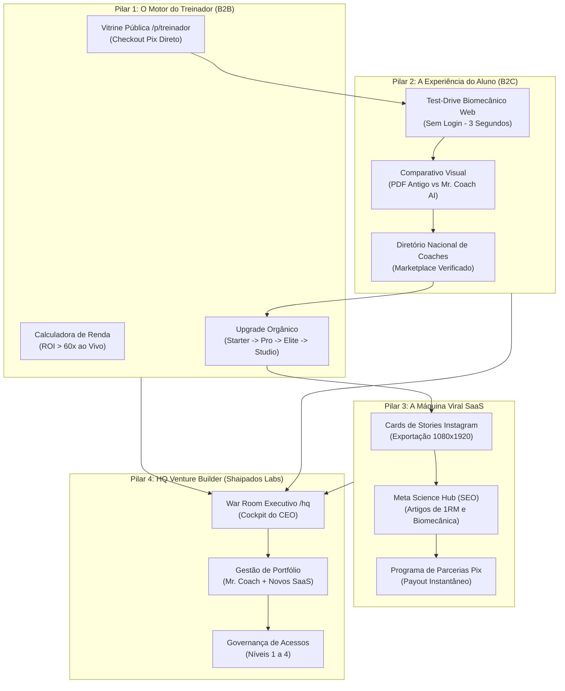
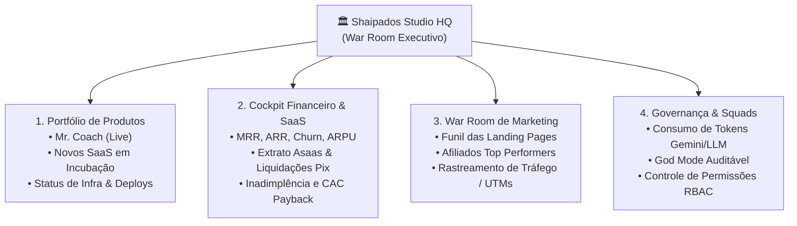
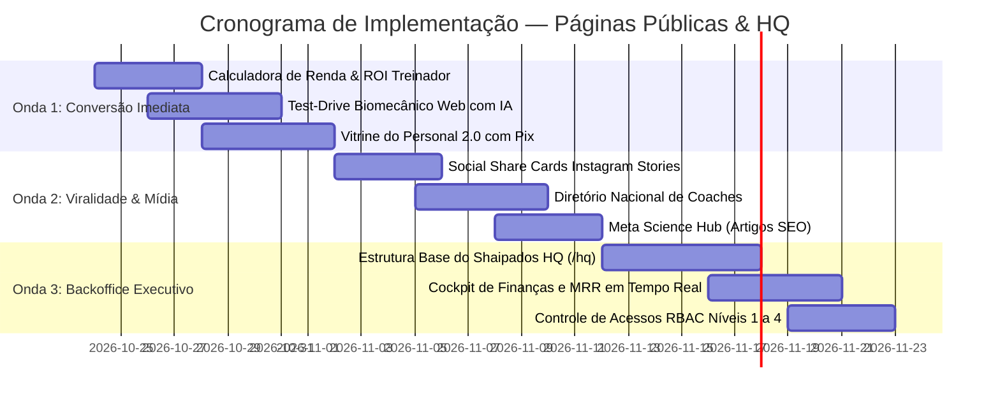

# 🚀 Proposta Estratégica: Modernização das Páginas Públicas, Motor Viral e Backoffice Executivo (HQ)
## Ecossistema Mr. Coach & Shaipados Labs

> **Status:** PROPOSTA ESTRATÉGICA (Para Processamento & Aprovação)  
> **Data de Emissão:** 23 de Outubro de 2026  
> **Liderança & Direção:** Prof. Cleudson Cavalcante (CEO / CPO)  
> **Elaboração:** Antigravity / Tech Lead (Squad Galaxy & Squad Lenovo)  
> **Escopo:** Páginas Públicas Comerciais, Vitrine do Treinador, Test-Drive do Aluno, Motor Viral e Módulo Privativo HQ (Venture Builder)  
> **Guardrails Obrigatórios:** `Visual_Edge_to_Edge_Mobile.md`, `design_system_meta_style.md` e `squad_mrcoach.md`  

---

## 1. Visão Geral & Justificativa Estratégica

O ecossistema **Mr. Coach** consolidou uma arquitetura mobile e backend de nível internacional (v1.9.0 com 151.814 linhas de código, 44 migrações SQL com RLS e 227 testes automatizados verdes). O produto interno — a experiência do aluno nas 4 abas e o cockpit do professor — atingiu maturidade de produto acabado.

O desafio atual é a **virada de chave comercial e de escala pública**:
1. **Para o Treinador (B2B):** A plataforma pública precisa ser uma alavanca de vendas para que ele atraia dezenas de novos alunos de consultoria online. Quanto mais alunos ele conquista, mais rapidamente atinge os limites dos planos e faz upgrade orgânico (*Starter → Pro → Elite → Studio*).
2. **Para o Aluno (B2C):** O frequentador de academia (iniciante ou avançado) deseja contratar acompanhamento profissional, mas hesita por medo de pagar por uma "planilha de PDF fria" que ninguém acompanha. A página pública deve demonstrar a superioridade e a segurança biomecânica da consultoria com IA antes mesmo do cadastro.
3. **Para o SaaS (Mr. Coach):** O software precisa se tornar viral por design. Cada treino concluído, cada recorde batido e cada prescrição deve gerar ganchos orgânicos nas redes sociais (Instagram Stories, TikTok e WhatsApp), criando um loop de crescimento onde o sucesso do aluno atrai novos personals.
4. **Para a Venture Builder (Shaipados Labs):** É imperativo estruturar um espaço privativo e governado (**HQ / War Room Executivo**) onde o CEO, diretores e squads tenham visibilidade em tempo real do portfólio de produtos (prontos e em P&D), finanças (MRR, ARR, liquidações Pix), campanhas de marketing e controle de acessos (RBAC).

---

## 2. Benchmark de Mercado: Como os Grandes Players Pensam e Executam

Para garantir uma solução de classe mundial, a proposta transpõe estratégias consagradas dos maiores players de tecnologia do planeta:

| Player Global | Princípio Estratégico | Como Executam na Web Pública | Transposição para o Mr. Coach |
|---|---|---|---|
| **Shopify & Substack** | **"Merchant Success Flywheel"** (O sucesso da plataforma depende do faturamento do cliente). | Fornecem vitrines ultra-otimizadas para que o profissional venda seu trabalho sem atrito de tecnologia. | A **Vitrine do Treinador (`/p/{username}`)** torna-se uma máquina de vendas com contratação Pix direta. |
| **Stripe & Vercel** | **"Show, Don’t Tell"** (Demonstração interativa ao vivo antes do login). | Widgets interativos na homepage que permitem ao visitante rodar código ou testar simulações em 3 segundos. | **Test-Drive Biomecânico na Landing Page**: o aluno testa a IA corrigindo uma dor em 3 segundos sem cadastro. |
| **Whoop & Apple Fitness+** | **"Ciência & Prestígio Social"** (Transformar dados técnicos em símbolos de status). | Telas de compartilhamento esteticamente impecáveis que transformam esforço físico em prova social compartilhável. | **Stories Card 1-Click**: Cards verticais de recorde de carga e streak com selo *"Treino auditado por Mr. Coach AI"*. |
| **Linear & Nubank** | **"Design como Vantagem Competitiva Inegociável"** | Minimalismo radical, Dark Glassmorphism refinado, zero lentidão e micro-interações táteis. | Landing Pages no padrão Bento Grid com paleta Esmeralda/Slate, tipografia tabular e fluidez a 120 FPS. |

---

## 3. Os 4 Pilares da Proposta



---

### PILAR 1: O Motor de Crescimento do Treinador (Flywheel de Upgrade)
> **Objetivo Comercial:** Capacitar o personal trainer a captar tantos alunos de consultoria online que o upgrade de plano se torne uma decisão matemática inevitável.

#### 1.1. Vitrine Pública do Personal 2.0 (`/p/{username}`)
Hoje a vitrine atua como uma página básica de perfil. Ela será reformulada para ser a **página oficial de vendas do personal trainer**:
- **Hero de Autoridade:** Foto profissional em alta resolução, selo oficial de CREF Verificado, bio persuasiva e tags de especialidades (Ex.: *Hipertrofia Avançada*, *Reabilitação de Joelho/Ombro*, *Emagrecimento Acelerado*).
- **Galeria Interativa Antes & Depois:** Visualizador com slider horizontal interativo, fotos sincronizadas com marca d'água anti-fraude e tempo de evolução (ex.: *"12 semanas de periodização"*).
- **Contratação & Checkout Transparente com Pix Instantâneo:** O aluno pode selecionar o plano de consultoria do personal (mensal, trimestral, semestral), ler o contrato e pagar via Pix Copia e Cola / QR Code gerado pelo Asaas em segundos.
- **Botão Inteligente de WhatsApp:** Canal direto com mensagem pré-configurada para tirar dúvidas caso o lead prefira contato humano antes da compra.

#### 1.2. Calculadora Interativa de Faturamento na Landing Page
Na landing page do personal (`mrcoach.shaipados.com`), um simulador interativo baseado em dados reais de mercado:
- O personal ajusta dois controles deslizantes:
  - *Quantos alunos você pretende atender?* (Slider de 5 a 100).
  - *Qual o valor da sua mensalidade de consultoria?* (Slider de R$ 100 a R$ 500).
- **Cálculo em Tempo Real:**
  - *"Com 30 alunos a R$ 250,00, sua receita mensal será de **R$ 7.500,00**."*
  - *"Tempo gasto tradicional: 30 horas/mês digitando planilhas."*
  - *"Tempo com Mr. Coach AI: **30 minutos/mês**."*
  - *"Custo da plataforma: R$ 89,00 (apenas **1,18%** da sua receita bruta)."*
  - **Botão de Ação:** *"Começar Gratuitamente no Starter Trial"*.

#### 1.3. Esteira de Notificação Celebratória de Upgrade (PLG)
- Ao cadastrar o 3º aluno no plano gratuito *Starter*, o painel do treinador exibe um modal elegante de conquista:
  > *"🎉 Parabéns, Coach! Você atingiu o teto da sua degustação gratuita com 3 alunos ativos. Mais de 87% dos treinadores que migram para o Plano Pro dobram sua carteira nos primeiros 45 dias. Desbloqueie até 30 alunos agora com 20% OFF no anual."*

---

### PILAR 2: A Experiência do Aluno (Quebra de Objeções & Test-Drive Imediato)
> **Objetivo Comercial:** Eliminar o medo do aluno de academia que deseja consultoria, mas teme gastar dinheiro com um serviço distante, confuso ou ineficaz.

#### 2.1. Test-Drive Biomecânico Web (Sem Login / Sem Fricção)
Diretamente na página pública, um componente interativo simulando a inteligência do Mr. Coach:
- **Passo 1:** O visitante escolhe um exercício clássico (ex.: *Agachamento Livre* ou *Supino Reto*).
- **Passo 2:** Seleciona uma queixa comum (ex.: *“Sinto dor na lombar no final do movimento”* ou *“Meu ombro estala na descida”*).
- **Resposta Instantânea da IA:**
  - Em 2 segundos, o simulador exibe o diagnóstico biomecânico e a sugestão de adaptação (ex.: substituição por *Agachamento Búlgaro* com tronco inclinado a 20º para descompressão discal).
- **Gatilho de Conversão:**
  - *"Essa é a proteção biomecânica que acompanha você a cada série. Quer treinar com segurança? Contrate um personal trainer credenciado pelo Mr. Coach."*

#### 2.2. O Comparativo Definitivo: "Consultoria Antiga" vs. "Mr. Coach AI"
Tabela visual com design Bento Grid desmistificando o modelo:

| Critério | Consultoria Antiga (Planilha / PDF) | Consultoria Moderna Mr. Coach AI |
|---|---|---|
| **Aparelho Ocupado na Academia** | O aluno fica perdido ou faz qualquer máquina sem critério. | A IA sugere substituição biomecânica idêntica em 5 segundos. |
| **Dor Articular Inesperada** | Aluno força o movimento, lesiona e abandona o treino. | Aluno reporta no app; ficha recalcula e avisa o treinador. |
| **Controle de Cargas e 1RM** | Anotações soltas no bloco de notas do celular que se perdem. | Gráficos automáticos de sobrecarga com fórmulas de Epley e Brzycki. |
| **Descanso Entre Séries** | Aluno se distrai no Instagram e perde o estímulo hipertrófico. | Rest timer cadenciado na tela com alerta tátil e sonoro. |
| **Acompanhamento do Coach** | Respostas demoradas e sensação de abandono. | Presença contínua, histórico de assiduidade e WhatsApp ativo. |

#### 2.3. Diretório Nacional de Treinadores Verificados ("Encontre seu Coach")
- Uma central pública pesquisável (`/coaches` ou `/treinadores`) onde alunos de todo o país podem filtrar personals por:
  - Objetivo (Hipertrofia, Queima de Gordura, Idosos, Gestantes, Reabilitação).
  - Modalidade (Online 100%, Presencial ou Híbrido).
  - Cidade / Estado.
- Cada personal listado ganha leads orgânicos gerados pelo próprio tráfego do SaaS.

---

### PILAR 3: A Máquina Viral do Mr. Coach (Visibilidade & Redes Sociais)
> **Objetivo Comercial:** Fazer o software se autopromover organicamente a cada treino executado.

#### 3.1. Social Share Cards para Instagram Stories (1080×1920) em 1 Clique
No final de cada treino ou ao conquistar um recorde pessoal (PR), o aluno encontra o botão **"Compartilhar Conquista"**:
- O app compila instantaneamente um layout editorial esportivo de alto impacto (estética *Whoop / Nike Training*):
  - Nome do Aluno e Foto de Perfil com Anel de Meta.
  - Carga levantada ou tonelagem total superada (ex.: *“Novo Recorde: 120 kg no Leg Press (+15 kg)”*).
  - Badge de Nível (Bronze, Prata, Ouro, Diamante).
  - Logo do Personal Trainer responsável.
  - Rodapé elegante com selo: **`Treinado com Mr. Coach AI • shaipados.com`**.
- O card é salvo na galeria ou enviado diretamente para o Instagram Stories com 1 toque, gerando prova social gratuita.

#### 3.2. Meta Science Hub (SEO Orgânico de Alta Autoridade)
- Criação de uma seção de artigos técnicos e científicos na web pública:
  - Conteúdos rápidos e densos sobre periodização linear vs. ondulatória, cálculos de volume semanal de séries (MEV/MAV/MRV), e biomecânica do manguito rotador.
  - Personals e estudantes de Educação Física que buscam termos técnicos no Google caem diretamente no ecossistema e descobrem a ferramenta de prescrição automatizada.

#### 3.3. Programa de Parcerias e Afiliados com Payout Pix Instantâneo
- Utilização do motor de pagamentos já implementado no backend para comissionar treinadores e influenciadores que indicarem o Mr. Coach para outros colegas:
  - Link exclusivo `/r/{slug}`.
  - Comissões recorrentes com liquidação Pix direta pelo painel administrativo.

---

### PILAR 4: O "War Room / HQ" da Venture Builder (Shaipados Labs)
> **Objetivo de Governança:** Criar a cabine de comando executiva privativa para o CEO e os times administrativo, financeiro, marketing e produto governarem o ecossistema.

#### 4.1. Arquitetura do Espaço Privativo (`/hq` ou `hq.shaipados.com`)
O módulo HQ será um ambiente blindado por autenticação de múltiplos fatores (MFA/TOTP) e restrito a papéis corporativos:



#### 4.2. Matriz de Permissões e Acessos (RBAC Corporativo)

| Nível de Acesso | Cargos Designados | O que pode Visualizar e Operar |
|---|---|---|
| **Nível 1 — Presidência / CEO** | Prof. Cleudson Cavalcante | **Acesso total e irrestrito**: Valuation, contas bancárias, autorização de saques Pix, desligamento de instâncias, aprovação de lançamentos e precificação de novos produtos. |
| **Nível 2 — Diretoria Financeira** | Equipe Financeira / Contábil | Visualização de balanços, conciliação bancária Asaas, taxas de gateway, relatórios fiscais, notas fiscais e controle de assinaturas inadimplentes. |
| **Nível 3 — Growth & Marketing** | Sarah, Sofia e Time de Tráfego | Monitoramento do tráfego das landing pages, taxa de conversão do simulador de IA, ranking de afiliados, criação de cupons e métricas de campanhas. |
| **Nível 4 — Engenharia & Suporte** | Arthur (Tech Lead), Beto (SRE), Alan e Marta | Monitoramento de esteiras CI/CD, métricas de consumo da API do Gemini, latência de servidores, logs de instâncias WhatsApp e atendimento N2. |

---

## 4. Topologia Técnica Monorepo & Roteamento por Domínio

Para manter o custo de infraestrutura próximo a zero e preservar a facilidade de manutenção, todas as páginas públicas e privadas coexistirão no mesmo Monorepo Flutter Web hospedado no Firebase Hosting, com roteamento dinâmico no `main.dart`:

```dart
// Roteamento inteligente baseado no subdomínio (Domain-Aware Routing)
final host = Uri.base.host;

if (host.contains('hq.') || (host.contains('app.') && path == '/hq')) {
  return const StudioHqScreen(); // Backoffice Executivo Privativo
} else if (host.contains('mrcoach.')) {
  return const MrCoachB2BLandingScreen(); // Landing Page Comercial do Treinador
} else if (host.contains('shaipados.')) {
  return const ShaipadosStudioScreen(); // Vitrine da Venture Builder
} else {
  return const AuthGate(); // App Mobile / PWA do Treinador e Aluno
}
```

---

## 5. Cronograma de Entrega Recomendado (3 Ondas)



### Onda 1 — Máxima Conversão de Vendas (Prazo estimado: 7 a 10 dias)
- Implementação da **Calculadora Interativa de Faturamento** na landing page B2B.
- Desenvolvimento do **Widget de Test-Drive de IA** (simulação imediata sem cadastro).
- Redesign da **Vitrine Pública do Treinador (`/p/{username}`)** com comparador de antes/depois e checkout de consultoria via Pix.

### Onda 2 — Viralidade e Máquina de Mídia (Prazo estimado: 7 a 10 dias)
- Mecanismo de exportação de **Instagram Stories em 1 toque** para conquistas do aluno.
- Lançamento do **Diretório Público de Coaches Credenciados**.
- Publicação da primeira esteira de artigos técnicos no **Meta Science Hub** para captação orgânica via Google.

### Onda 3 — O War Room Corporativo / Shaipados HQ (Prazo estimado: 10 a 14 dias)
- Desenvolvimento do painel executivo `/hq` com tela de portfólio de produtos.
- Dashboard financeiro consolidado (MRR, ARR, extrato Asaas, taxas de churn).
- Implementação da matriz de controle de permissões por perfil (RBAC Níveis 1 a 4).

---

## 6. Critérios de Aceite e Garantia de Qualidade

1. **Responsividade & Edge-to-Edge:** Todas as landing pages devem funcionar perfeitamente em telas móveis (iOS Safari, Android Chrome) e desktop, respeitando a diretriz `Visual_Edge_to_Edge_Mobile.md`.
2. **Performance Instantânea:** Carregamento de landing pages com tempo de First Contentful Paint (FCP) inferior a 1,2 segundos.
3. **Segurança Militar no HQ:** O módulo executivo `/hq` não pode ter rotas vazadas no cliente; toda operação crítica de dados deve validar autenticação JWT, flag `is_admin` e MFA ativo via Supabase RLS.
4. **Zero Warnings & Testes:** Todo novo código deve passar limpo no `flutter analyze` e acompanhar testes automatizados de widget e serviço.

---

## 7. Decisões Estratégicas para o CEO / Direção

Para darmos início à execução da Onda 1, submetemos à avaliação:
1. **Aprovação do Escopo da Onda 1:** Iniciar pela Calculadora de Faturamento do Treinador e pelo Test-Drive de IA na web pública?
2. **Definição da Vitrine do Treinador:** Os planos de consultoria do personal na vitrine terão checkout direto via Pix do Asaas ou redirecionamento inicial para o WhatsApp do treinador?
3. **Alinhamento do Backoffice HQ:** Prefere que o painel executivo seja hospedado no subdomínio `hq.shaipados.com` ou acessível como rota restrita `/hq` dentro do próprio portal web?
